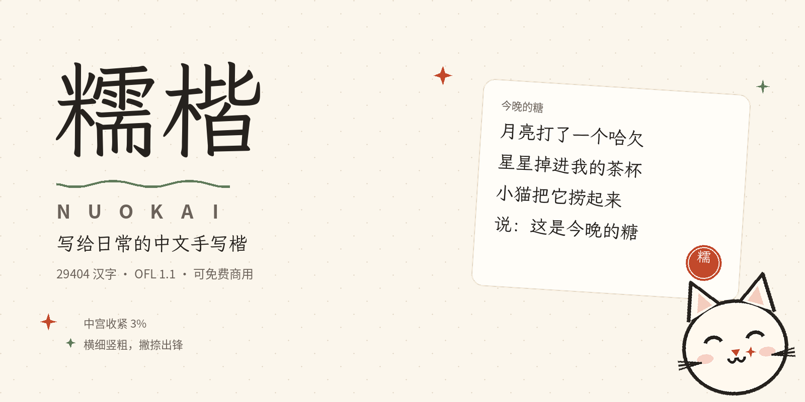
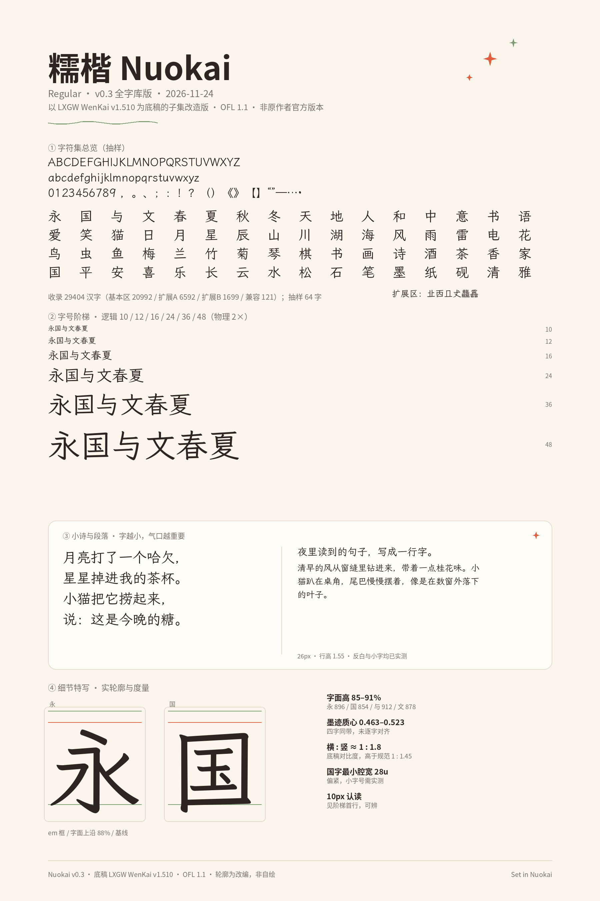
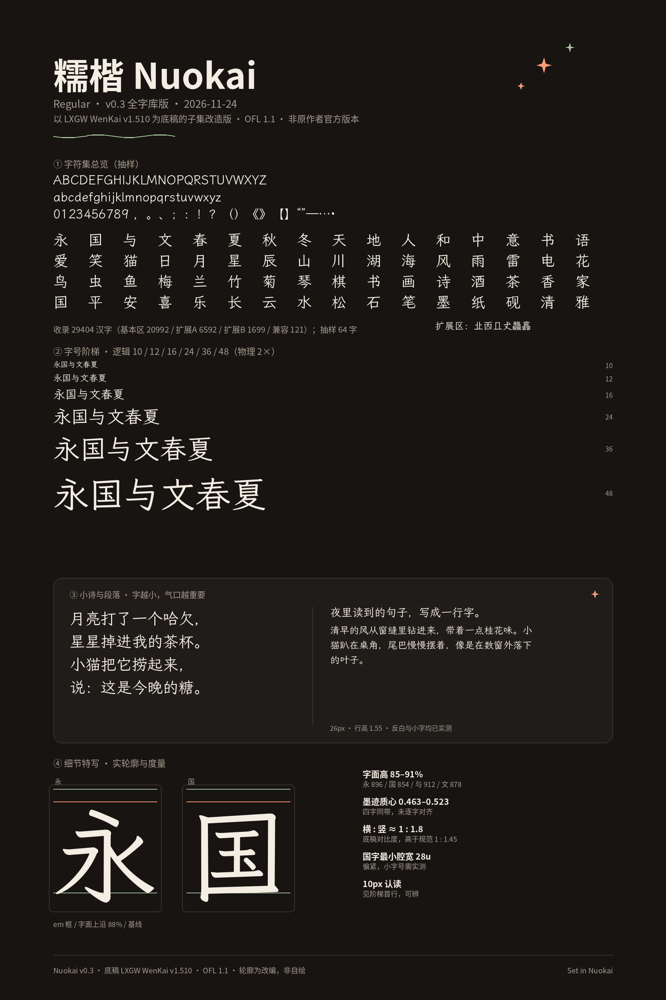
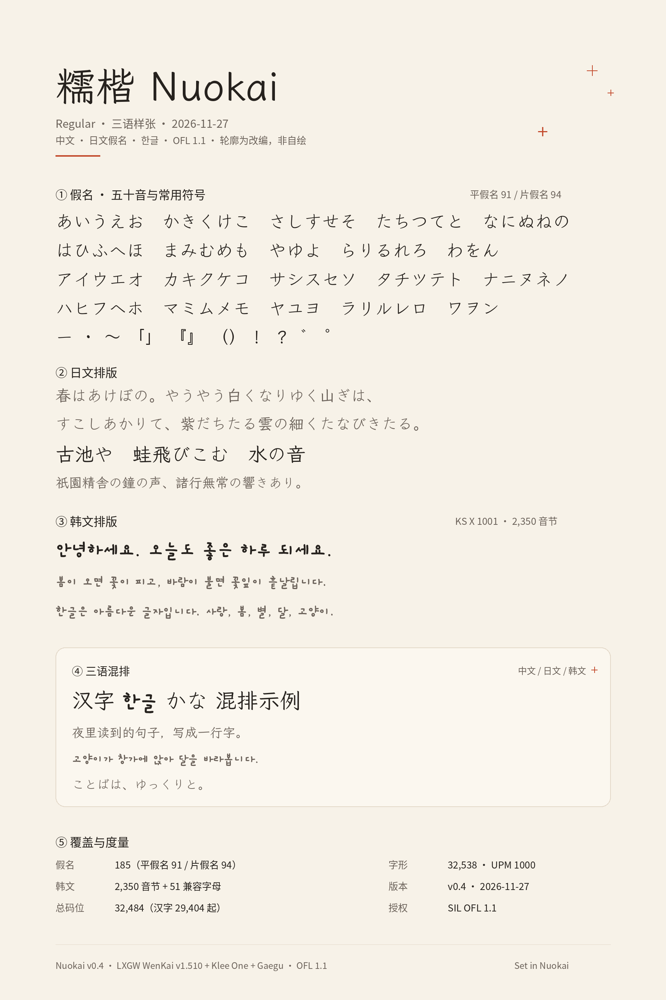

<p align="center">
  
</p>

<h1 align="center">糯楷 Nuokai</h1>

<p align="center">
  从霞鹜文楷改造而来的开源中文手写楷体，覆盖 29,404 个汉字，并补充日文假名与韩文常用音节。
</p>

<p align="center">
  <a href="https://github.com/Euphrosina/nuokai/releases"></a>
  <a href="#覆盖范围"></a>
  <a href="#多语言支持"></a>
  <a href="LICENSE"></a>
  <a href="fonts"></a>
</p>

<p align="center">
  <a href="https://37lozzwxvs7bdzqhndp.traesite.cn">在线预览与下载</a>
  ·
  <a href="https://37lozzwxvs7bdzqhndp.traesite.cn/README.html">详细说明</a>
  ·
  <a href="OFL.txt">许可证原文</a>
</p>

## 目录

- [简介](#简介)
- [特性](#特性)
- [预览](#预览)
- [覆盖范围](#覆盖范围)
- [多语言支持](#多语言支持)
- [字体规格](#字体规格)
- [安装](#安装)
- [在网页中使用](#在网页中使用)
- [重新生成网页子集](#重新生成网页子集)
- [已知限制](#已知限制)
- [常见问题](#常见问题)
- [授权](#授权)
- [贡献](#贡献)
- [致谢](#致谢)
- [变更记录](#变更记录)

## 简介

糯楷是一套面向日常排版的开源中文手写楷体。它以开源字体 **LXGW WenKai v1.510 Regular** 为底稿，保留原有的起笔顿挫、收笔出锋与笔画弧势，再把每个字的内部空间沿字面框中心收紧 3%，让整段文字读起来更聚、更安静。

它的字形偏圆润，结构不张扬，横细竖粗但不夸张，适合正文、注释、书摘、菜单、包装文案和轻量品牌字。笔画转折保留手写感，小字号下不会像硬笔字那样发飘，大字号下也能看到撇捺的渐细与出锋。

关于名字：收紧后的字面像一枚捏得圆圆的糯米团，所以叫“糯楷”。这不是一个严肃的书法复刻，也不打算替代宋体或黑体，它更像是在正文和手写之间留出的一个温和选项。

v0.4 起补充了日文与韩文：185 个假名取自与底稿同源的 Klee One，2,350 个韩文常用音节与 51 个兼容字母取自 Gaegu。两者都是 SIL Open Font License 1.1 授权，来源与版权见[多语言支持](#多语言支持)与[授权](#授权)两节。

**需要明确的是：本仓库不是原创字形。** 轮廓来自 LXGW WenKai v1.510，本版按照 SIL Open Font License 1.1 做了子集化、3% 中宫收紧和改名。原作者 LXGW 未参与本版制作，也未为本版背书。完整的来源、版权与保留字体名说明见[授权](#授权)一节。

## 特性

- **29,404 个汉字**：基本区 20,992 字全覆盖，另有扩展 A、扩展 B 与兼容区字形。
- **185 个日文假名**：平假名 91、片假名 94，字形来自与底稿同源的 Klee One。
- **2,350 个韩文音节**：KS X 1001 常用音节，另含 51 个兼容字母，字形取自 Gaegu。
- **32,484 个码位**：包含 ASCII、中文标点、全角符号、CJK 符号、假名与韩文。
- **统一收紧 3% 中宫**：只压缩字形内部空间，外框与字宽保持不变，不破坏原有骨架。
- **两种格式**：完整 TTF 用于安装，约 1.4 MiB 的 WOFF2 子集用于网页展示。
- **OFL 1.1 授权**：允许免费使用、修改、再分发与商用，再分发时须保留版权与许可证。
- **命名合规**：已改名 Nuokai，未使用“霞鹜”“LXGW”等保留字体名。

## 预览

<p align="center">
  
</p>

| 浅色样张 | 深色样张 |
| :---: | :---: |
| [](assets/preview-light.png) | [](assets/preview-dark.png) |

样张包含字符集总览、字号阶梯、一首小诗、段落样本与“永 / 国”细节特写。点击图片可查看 1800 × 2700 原图。

三语样张（中文、日文假名与韩文）：

<p align="center">
  
</p>

## 覆盖范围

| 区域 | 码位 | 字数 | 说明 |
| --- | --- | ---: | --- |
| 基本区 | U+4E00 至 U+9FFF | 20,992 | 全覆盖，缺字 0 |
| 扩展 A | U+3400 至 U+4DBF | 6,592 | 底稿所含 |
| 扩展 B 及以后 | U+20000 起 | 1,699 | 底稿所含部分 |
| 兼容区 | U+F900 至 U+FAFF | 121 | 底稿所含 |
| **汉字合计** |  | **29,404** |  |
| 平假名 | U+3040 至 U+309F | 91 | 取自 Klee One |
| 片假名 | U+30A0 至 U+30FF | 94 | 取自 Klee One |
| 韩文音节 | U+AC00 至 U+D7A3 | 2,350 | KS X 1001 常用音节 |
| 韩文兼容字母 | U+3131 至 U+318E | 51 | 取自 Gaegu |
| 其他 | ASCII、中文标点、全角、CJK 符号 | 494 | 含半角假名与半角韩文 |
| **总码位** |  | **32,484** |  |

GB18030 全集不在底稿范围内，因此本版没有覆盖全部七万余汉字。扩展 B 只包含底稿自带的 1,699 字，不是完整扩展 B。韩文也不是完整的 11,172 个音节，只收 KS X 1001 的 2,350 个常用音节；日文汉字与中文共用 CJK 统一字形，没有额外添加日文专用旧字形。

## 多语言支持

### 日文

185 个假名来自 **Klee One**，这款字体也是霞鹜文楷的日文底稿，所以假名与汉字共用同一套起笔、收笔和转折方式，混排时不会突然换味。日文标点（「」『』、〜、・）随假名一并可用。

覆盖范围是平假名与片假名基本区，不含假名补充区与小型假名扩展。日文汉字直接使用 CJK 统一字形，没有针对日文新字体或旧字体做单独映射。

### 韩文

2,350 个音节来自 **Gaegu**，取的是它的粗体字重，以接近糯楷的笔画粗细。字宽保留源字体的 820 units，比中文的 1000 units 略窄，这是为了让韩文保持自己的节奏，不强行拉成方块。

只收 KS X 1001 常用音节，像“뷁”这类生僻音节不在范围内，遇到会回退到后一个字体。Gaegu 是独立设计，骨架与中文不是同一套，混排时能看出风格差异，这一点在授权与限制里都有说明。

### 授权

日文假名与韩文字形都来自 SIL Open Font License 1.1 授权的开源字体，版权分别归 Klee Project Authors 与 Gaegu Project Authors。再分发时请保留 [OFL.txt](OFL.txt) 中的版权声明与许可证。

## 字体规格

| 项目 | 数值 |
| --- | --- |
| 家族名 | Nuokai |
| 字重 | Regular |
| 版本 | v0.4（fontRevision 0.4） |
| UPM | 1000 |
| 字形数 | 32,538 |
| cmap 码位 | 32,484 |
| hhea 升降部 | 928 / -256 |
| OS/2 typo 升降部 | 880 / -120 |
| OS/2 win 升降部 | 1032 / 285 |
| vendor ID | NUKI |
| 文件大小 | 19,728,512 字节（18.81 MiB） |
| SHA-256 | `845aa262b03d95cdab5a6093128d45a2299faecb84b2d3ccbf3c9479f74560a7` |

## 安装

### Windows 与 macOS

1. 下载 `fonts/Nuokai-Regular.ttf`。
2. 双击文件，选择“安装”。
3. 如果系统里已有旧版 Nuokai，先卸载旧版，再安装新版。

### Linux

```bash
mkdir -p ~/.local/share/fonts
cp fonts/Nuokai-Regular.ttf ~/.local/share/fonts/
fc-cache -f
fc-list | grep Nuokai
```

## 在网页中使用

仓库里的 `fonts/Nuokai-web.woff2` 是网页子集，包含 ASCII、GB2312 一级字、日文假名、2,350 个韩文常用音节和示例用字，适合做展示，不建议安装到系统。完整字形请使用 TTF。

```css
@font-face {
  font-family: "Nuokai";
  src: url("/fonts/Nuokai-web.woff2") format("woff2");
  font-weight: 400;
  font-style: normal;
  font-display: swap;
}

body {
  font-family: "Nuokai", serif;
}
```

如果需要覆盖全部 29,404 字，可以自己从 TTF 生成完整网页字体，或直接使用 TTF。网页子集遇到生僻字会回退到后一个字体，这是预期行为。

## 重新生成网页子集

需要 Python 3.9 及以上版本，并安装 `fonttools` 与 `brotli`：

```bash
python3 -m pip install fonttools brotli
python3 scripts/build_web_subset.py
```

脚本会读取 `fonts/Nuokai-Regular.ttf`，生成 `fonts/Nuokai-web.woff2`，字符集为 ASCII、GB2312 一级字、日文假名、韩文常用音节和少量示例字。修改字符集后重新运行即可。当前子集约 1.4 MiB。

## 已知限制

- **轮廓非自绘**：本版是 OFL 允许的修改版，不是原创设计。需要完全原创的字形，请从骨架开始重画。
- **未做 hinting**：小字号在部分低分辨率屏幕上可能略软。
- **未覆盖 GB18030 全集**：底稿本身不含全部扩展区汉字。
- **韩文范围有限**：只收 2,350 个 KS X 1001 常用音节，生僻音节会回退到后一个字体。
- **韩文风格不完全同源**：Gaegu 是独立手写字体，骨架与中文不同，字宽为 820 units。
- **假名没有扩展**：不含假名补充区、小型假名扩展与日文专用旧字形。
- **度量有偏差**：字面高约 85% 至 91%，横竖比约 1:1.8，高于手写楷常见的 1:1.3 至 1:1.6；“国”字最小腔宽 28 units，偏紧。
- **只有 Regular**：没有粗体、细体或斜体，需要其他字重只能另行派生。
- **网页子集不完整**：`Nuokai-web.woff2` 只覆盖常用字。

## 常见问题

### 下载后文件名变成 `Nuokai-Regular.ttf.otf`

文件本体是 TrueType，文件头为 `0x00010000`，轮廓表为 `glyf`。多出来的 `.otf` 是部分下载器按字体 MIME 自动追加的后缀，把文件名改回 `.ttf` 即可。也可以从 ZIP 包解压得到正确文件名。

### 安装后还是旧字形

系统里可能还留着旧版 Nuokai（v0.2 只有 5 个字）。先在字体管理器中卸载旧版，再安装 v0.4，并重启正在使用该字体的应用。

### 可以商用吗

可以。OFL 1.1 允许免费使用、修改、再分发和商用，包括嵌入网页、App、视频和印刷品。再分发字体文件时须保留版权声明与许可证，修改版不得使用原作者的保留字体名。

### 可以修改吗

可以。修改版必须继续使用 OFL 1.1，并且不能使用“霞鹜”“LXGW”等保留字体名。若只是重新编译、子集化或转换为网页格式，请同时遵守底稿的附加许可条款，详见 [OFL.txt](OFL.txt)。

### 支持日文和韩文吗

支持常用范围。日文有 185 个假名与常用日文标点，日文汉字使用 CJK 统一字形；韩文有 2,350 个 KS X 1001 常用音节和 51 个兼容字母。生僻韩文音节与假名扩展区不在范围内。

### 韩文为什么和中文风格不完全一样

韩文字形来自 Gaegu，是另一款独立设计的手写字体，只借用字形，不改变它的骨架与比例。为了让字重更接近中文，合并时取的是 Gaegu 的粗体字重。混排时能看出差异，这是合并多款开源字体的正常结果。

### 日文假名和中文像吗

像。假名来自 Klee One，而霞鹜文楷本身就是基于 Klee One 开发的，所以假名与汉字共享同一套笔画语言。合并时也对假名做了与正文一致的 3% 中宫收紧。

### 为什么不做成 OTF

TTF 使用二次曲线 `glyf` 轮廓，OTF 通常使用三次曲线 `CFF`。两者不能靠改后缀互换，转成 OTF 需要重新转换轮廓，字形会有细微变化。当前版本面向安装与网页使用，TTF 已经足够。

### 为什么网页上有些字变成了别的字体

网页试打样使用的是约 1.4 MiB 的 WOFF2 子集，只含常用字、假名与韩文常用音节。安装完整 TTF 后，全部 32,484 个码位都可用。

## 授权

本字体以 **SIL Open Font License 1.1** 发布。许可证全文见 [OFL.txt](OFL.txt) 与 [LICENSE](LICENSE)。

- 版权：Copyright 2021-2026 LXGW；部分字形源自 Klee One (Fontworks)；韩文字形 Copyright 2018 The Gaegu Project Authors。
- 底稿：LXGW WenKai v1.510 Regular，仓库为 <https://github.com/lxgw/LxgwWenKai>。
- 日文假名：Klee One，仓库为 <https://github.com/fontworks-fonts/Klee>。
- 韩文音节：Gaegu，仓库为 <https://github.com/google/fonts/tree/main/ofl/gaegu>。
- 保留字体名：“霞鹜”“霞鶩”“落霞孤鹜”“落霞孤鶩”“LXGW”。本版已改名为 Nuokai，未使用上述名称。
- 关系说明：本版是社区修改版，与原作者无隶属或背书关系。

再分发时请保留版权声明、许可证与保留字体名条款。修改版不得使用原作者的保留字体名，除非获得书面许可或符合底稿的附加许可条件。

## 贡献

欢迎提交 Issue 与 Pull Request，尤其是：

- 具体字形的笔画、字腔或间距问题，请附上字号、渲染环境和截图。
- 网页子集的字符覆盖建议。
- 文档、示例与构建脚本的改进。

提交字形修改时，请确保轮廓为自行绘制或来自本仓库已授权的底稿，不要提交来自其他版权字体的轮廓。修改后请附上一段包含该字的测试文本与渲染结果。

## 致谢

- [LXGW WenKai](https://github.com/lxgw/LxgwWenKai) 提供底稿与完整的开源授权。
- [Klee One](https://github.com/fontworks-fonts/Klee) 与 Fontworks 提供部分原始字形，以及全部日文假名。
- [Gaegu](https://github.com/google/fonts/tree/main/ofl/gaegu) 提供韩文音节字形。
- [fontTools](https://github.com/fonttools/fonttools) 提供子集化与字体构建工具。
- 所有反馈字形问题、帮忙测试小字号与生僻字的使用者。

## 变更记录

| 版本 | 日期 | 说明 |
| --- | --- | --- |
| v0.4 | 2026-11-27 | 新增 185 个假名、2,350 个韩文音节与 51 个兼容字母；字形增至 32,538；网页子集扩至 1.4 MiB；新增三语样张 |
| v0.3 | 2026-11-24 | 汉字由 6,763 扩到 29,404；新增 WOFF2 子集、诗样张与网页说明 |
| v0.2 | 2026-11-24 | 首个全字库版本，GB2312 6,763 汉字 |
| v0.1 | 2026-11-24 | 5 个定调字，仅用于结构试验 |

## 相关链接

- 在线预览与下载：<https://37lozzwxvs7bdzqhndp.traesite.cn>
- 详细说明页：<https://37lozzwxvs7bdzqhndp.traesite.cn/README.html>
- 许可证：<https://37lozzwxvs7bdzqhndp.traesite.cn/OFL.html>
- 底稿仓库：<https://github.com/lxgw/LxgwWenKai>

---

<p align="center">
  Nuokai v0.4 · 底稿 LXGW WenKai v1.510 · 假名 Klee One · 韩文 Gaegu · SIL Open Font License 1.1 · 轮廓为改编，非自绘
</p>
